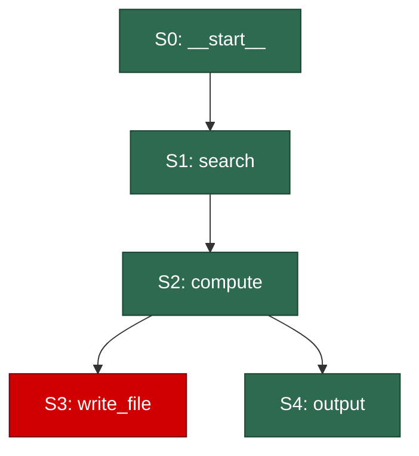

<p align="center">
  <h1 align="center">🛡️ DriftGuard</h1>
  <p align="center"><strong>A State-Aware Rollback and Trajectory-Replanning Framework for Autonomous LLM Agents</strong></p>
  <p align="center">
    <a href="https://github.com/imsanjoykb/agents-driftguard/actions/workflows/test.yml"></a>
    <a href="https://pypi.org/project/agents-driftguard/"></a>
    <a href="https://pypi.org/project/agents-driftguard/"></a>
    <a href="https://opensource.org/licenses/MIT"></a>
    <a href="https://github.com/psf/black"></a>
  </p>
  <p align="center">
    <a href="#installation">Installation</a> •
    <a href="#quickstart">Quickstart</a> •
    <a href="#how-it-works">How it Works</a> •
    <a href="#api-reference">API Reference</a> •
    <a href="#integrations">Integrations</a>
  </p>
</p>

---

**DriftGuard** wraps any LLM agent executor with a causal state graph, automatic divergence detection, rollback to the last safe state, and failure-context-aware replanning — so your agents recover from mid-chain errors without full restarts.

## The Problem

Agents in multi-step tasks make errors mid-chain (tool failures, goal drift, infinite loops) and have no way to recover without a full restart. This wastes tokens, time, and context.

## The Solution

`DriftGuard` models an agent run as a causal graph of state transitions:

```
S0 → S1 → S2 → S3 (💥 error) 
              ↘ rollback → S2 → S4 (✅ success)
```

When divergence is detected, the system:
1. **Identifies** the failure via pluggable detectors
2. **Rolls back** to the last causally-safe state
3. **Replans** with failure context injected into the next prompt
4. **Resumes** — the agent tries a different strategy

## Installation

```bash
pip install agents-driftguard
```

With optional backends:

```bash
# Local embeddings (sentence-transformers)
pip install agents-driftguard[embeddings]

# OpenAI embeddings + function-calling adapter
pip install agents-driftguard[openai]

# LangChain integration
pip install agents-driftguard[langchain]

# Development
pip install agents-driftguard[dev]
```

## Quickstart

```python
from agents_driftguard import AgentUndoWrapper

# Your agent is just a callable: (prompt: str) -> str
def my_agent(prompt: str) -> str:
    # Call your LLM here
    return llm.generate(prompt)

# Wrap it with DriftGuard
wrapper = AgentUndoWrapper(
    executor=my_agent,
    max_rollbacks=3,
    detectors=["goal_drift", "tool_failure", "loop"],
    embedding_backend="dummy",  # or "sentence-transformers" / "openai"
)

# Run with automatic rollback protection
result = wrapper.run(goal="Research and summarize recent AI papers")

print(result.success)             # True/False
print(result.final_output)        # The agent's final answer
print(result.rollbacks_performed) # Number of rollbacks that occurred
print(result.causal_graph_mermaid) # Mermaid diagram of the state graph
```

## How it Works

### Execution Loop

```
┌────────────────────────────────────────────────┐
│                 AgentUndoWrapper                │
│                                                │
│  1. Call executor(prompt)                      │
│  2. Parse action + observation → AgentState    │
│  3. Embed current context → state_embedding    │
│  4. Add to CausalGraph                         │
│  5. Run DivergenceDetector                     │
│  6. If divergence detected:                    │
│     a. Mark node diverged                      │
│     b. Find safe rollback point                │
│     c. RollbackController.rollback()           │
│     d. Replanner.replan() → inject context     │
│     e. Resume from safe state                  │
│  7. Repeat until done or max_rollbacks         │
└────────────────────────────────────────────────┘
```

### Divergence Detectors

| Detector | What it catches | How |
|---|---|---|
| `GoalDriftDetector` | Agent wandering off-task | Cosine similarity between goal and state embeddings |
| `ToolFailureDetector` | Tool errors and crashes | Regex patterns in observations (errors, tracebacks, HTTP codes) |
| `LoopDetector` | Infinite loops | State hash deduplication over a sliding window |
| `ConstraintChecker` | Business rule violations | User-defined Python lambdas |
| `LLMJudge` | Subtle misalignment | Optional LLM-based scoring |
| `OutputQualityDetector` | Suspiciously poor outputs | Checking length and word repetition ratio |
| `TokenBudgetDetector` | Excessive API usage | Whitespace-based token estimation across state history |
| `HallucinationDetector` | Made-up information | Flagging confident uncertainty or apology patterns |

Detectors are combined with configurable strategies: `"any"` (default), `"all"`, or `"weighted"`.

### Causal Graph

Every agent run produces a causal DAG:



#### Dependency-Aware Rollback Traversal

Unlike naive sequential rollback systems, DriftGuard tracks resource inputs and outputs (e.g. specific files, SQL tables, code modules). When a tool failure signal registers a `failed_resource` (for instance, a `SyntaxError` in `utils.py`), DriftGuard:
1. Performs backwards graph traversal along causal ancestors.
2. Identifies the exact ancestor step that modified or created the failed resource.
3. Selects the step *immediately preceding* that ancestor as the target recovery state.
4. Unwinds the side-effects of all intermediate steps in reverse chronological order using their registered `@reversible` compensating hooks, preserving unrelated execution branches.

### Replanning

After rollback, the agent receives failure context:

```
=== ROLLBACK CONTEXT ===
You previously attempted: write_file(path='/protected/path')
This failed because: A tool call returned an error or unexpected result.
You have been rolled back to step 2.
Original goal: Analyze data and produce a summary report
Actions that led to failure (do NOT repeat this approach):
  - Step 3: write_file → 'Error: Permission denied'
Try a different strategy.
=== END ROLLBACK CONTEXT ===
```

## API Reference

### `AgentUndoWrapper`

```python
wrapper = AgentUndoWrapper(
    executor=my_fn,                    # callable: (str) -> str
    max_rollbacks=3,                   # max rollback attempts
    detectors=["goal_drift", "tool_failure", "loop"],
    goal_drift_threshold=0.75,         # cosine similarity threshold
    store="memory",                    # "memory" | "sqlite"
    constraints=[lambda s: ...],       # user-defined validators
    on_rollback=callback_fn,           # optional rollback hook
    embedding_backend="dummy",         # "dummy" | "sentence-transformers" | "openai"
    max_steps=50,                      # safety limit
    verbose=False,
)

result = wrapper.run(goal="your task")
```

### `AgentRunResult`

| Field | Type | Description |
|---|---|---|
| `success` | `bool` | Whether the agent completed successfully |
| `final_output` | `str` | The agent's final answer |
| `total_steps` | `int` | Total steps executed |
| `rollbacks_performed` | `int` | Number of rollbacks |
| `causal_graph_mermaid` | `str` | Mermaid diagram string |
| `rollback_history` | `list[RollbackResult]` | Detailed rollback logs |

### `@reversible` Decorator

Register undo functions for tools with side-effects:

```python
from agents_driftguard import reversible

def undo_write(args, result):
    os.remove(args["path"])

@reversible(undo_fn=undo_write, tool_name="write_file")
def write_file(path: str, content: str) -> str:
    with open(path, "w") as f:
        f.write(content)
    return f"Written to {path}"
```

During rollback, `undo_write` is automatically called to reverse the side-effect.

## Async Support

`DriftGuard` natively supports asynchronous agent execution using `AsyncAgentUndoWrapper`.

```python
import asyncio
from agents_driftguard.async_wrapper import AsyncAgentUndoWrapper

async def my_async_agent(prompt: str) -> str:
    # Await your LLM call here
    return await async_llm.generate(prompt)

async def main():
    wrapper = AsyncAgentUndoWrapper(executor=my_async_agent)
    result = await wrapper.arun(goal="Fetch async data")
    print(result.success)

asyncio.run(main())
```

## Live Web Dashboard

Launch the zero-dependency, local web dashboard to view telemetry in real-time.

```python
from agents_driftguard.dashboard.app import start_dashboard_server

# Start the dashboard in the background
start_dashboard_server(port=8050)

# Then run your agent
wrapper.run("Do work")
```
Navigate to `http://localhost:8050` in your browser to see your agent's timeline, causal graph visualization, and rollback events as they happen!

## Integrations

### LangChain

```python
from langchain.agents import AgentExecutor
from agents_driftguard.integrations.langchain import LangChainAdapter

executor = AgentExecutor(agent=..., tools=...)
adapter = LangChainAdapter(executor)

wrapper = AgentUndoWrapper(
    executor=adapter,
    step_parser=adapter.parse_step,
)
```

### OpenAI Function Calling

```python
from openai import OpenAI
from agents_driftguard.integrations.openai import OpenAIFunctionCallingAdapter

client = OpenAI()
adapter = OpenAIFunctionCallingAdapter(
    client=client,
    model="gpt-4o",
    tools=[...],
    tool_executor=my_tool_runner,
)

wrapper = AgentUndoWrapper(
    executor=adapter,
    step_parser=adapter.parse_step,
)
```

## State Stores

| Store | Backend | Persistence | Use Case |
|---|---|---|---|
| `InMemoryStateStore` | Python dict | No | Development, testing |
| `SQLiteStateStore` | SQLite (stdlib) | Yes | Production, debugging |

```python
# SQLite store
wrapper = AgentUndoWrapper(executor=fn, store="sqlite")

# Or bring your own
from agents_driftguard.store.sqlite import SQLiteStateStore
store = SQLiteStateStore(db_path="agent_states.db")
wrapper = AgentUndoWrapper(executor=fn, store=store)
```

## Development

```bash
# Install in development mode
pip install -e ".[dev]"

# Run tests
pytest agents_driftguard/tests/ -v

# Format
black agents_driftguard/

# Lint
ruff check agents_driftguard/
```

## Architecture

```
agents_driftguard/
├── __init__.py          # AgentUndoWrapper main API
├── core/
│   ├── state.py         # AgentState + StateStore protocol
│   ├── graph.py         # CausalGraph (NetworkX DAG)
│   ├── detector.py      # DivergenceDetector + sub-detectors
│   ├── rollback.py      # RollbackController + @reversible
│   └── replanner.py     # Failure-context injection
├── integrations/
│   ├── base.py          # Abstract adapter interface
│   ├── langchain.py     # LangChain adapter
│   └── openai.py        # OpenAI function-calling adapter
├── store/
│   ├── memory.py        # In-memory StateStore
│   └── sqlite.py        # SQLite StateStore
├── utils/
│   ├── embeddings.py    # Embedding backends
│   ├── visualize.py     # Mermaid graph export
│   └── hashing.py       # Deterministic state hashing
└── tests/
    ├── test_state.py
    ├── test_graph.py
    ├── test_detector.py
    ├── test_rollback.py
    └── test_wrapper.py  # End-to-end mock agent test
```

## Research Paper & Citation

If you use this framework in your research, please cite our paper:

```bibtex
@article{driftguard2026,
  title={DriftGuard: A State-Aware Rollback and Trajectory-Replanning Framework for Autonomous LLM Agents},
  author={Sanjoy Kumar},
  journal={Preprint / Working Paper},
  year={2026}
}
```

## License

MIT
