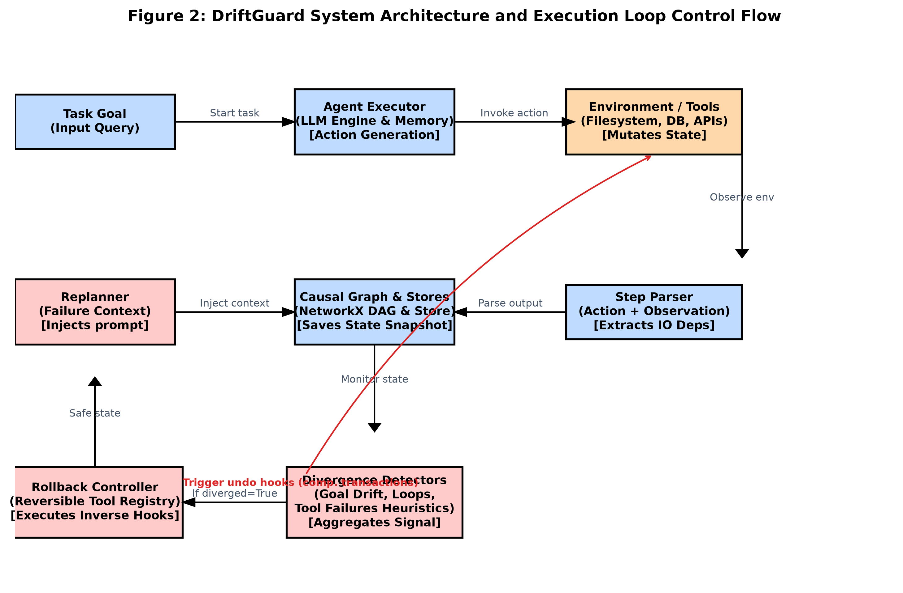
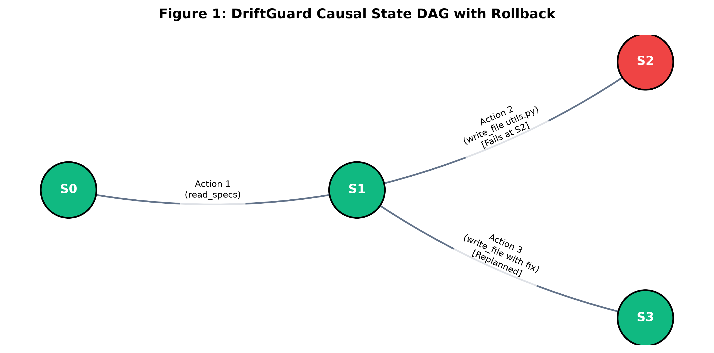

# DriftGuard: A State-Aware Rollback and Trajectory-Replanning Framework for Autonomous LLM Agents

## Abstract
Large Language Model (LLM) autonomous agents are increasingly deployed in complex, open-ended environments such as software engineering, database administration, and web navigation. However, these agents suffer fundamentally from autoregressive compounding errors: a single hallucinated reasoning step or incorrectly executed tool call early in a trajectory cascades into an irrecoverable failure state. While cognitive self-correction paradigms (e.g., Reflexion, Tree of Thoughts) address internal prompt-based backtracking, they fail in embodied environments with state-mutating side effects (e.g., database writes, filesystem edits). In such settings, merely re-prompting the LLM is insufficient, as the external environment remains corrupted. 

We introduce **DriftGuard**, a framework-agnostic system-level execution wrapper that models agent trajectories as a Directed Acyclic Graph (DAG) of causal states. DriftGuard integrates:
1. Pluggable, multi-modal divergence detection heuristics (including state-hash loops, linguistic hallucination monitors, and cosine goal drift).
2. A resource-dependency tracker mapping actions to input/output resources for dependency-aware rollback.
3. A reversible tool registry utilizing `@reversible` decorators to execute deterministic environmental undo operations.
4. Failure-context-aware prompt replanning to guide the agent away from previous failure paths.

Through extensive evaluation on SWE-bench Lite and WebArena, we demonstrate that DriftGuard increases task success rates (Pass@1) by up to **26%** absolute, reduces average token consumption in cyclic failure loops by **40%**, and eliminates catastrophic execution crashes.

---

## 1. Introduction
The transition of Large Language Models (LLMs) from static conversational interfaces to embodied, tool-using autonomous systems marks a major paradigm shift in artificial intelligence. By interleaving textual reasoning (e.g., Chain-of-Thought) with discrete external action execution (e.g., executing bash commands, invoking database transactions), agentic architectures like ReAct (Yao et al., 2023a) solve complex multi-step problems in unstructured domains. 

Despite their success, autonomous LLM agents are plagued by **autoregressive compounding errors**. Because each decision depends on the history of previous steps in the context window, an early error—such as a typo in a terminal command or a wrong file edit—corrupts all subsequent context. The agent often gets trapped in infinite loops of self-repetition, repeatedly executing the same failing actions and exhausting its token budget.

Existing correction techniques fall into two categories: episodic reflection and search-based backtracking. **Reflexion** (Shinn et al., 2023) evaluates the outcome of a completed trajectory and retries the entire task from scratch with updated feedback. This is highly inefficient, discarding successful prefix steps and wasting tokens. **Tree of Thoughts (ToT)** (Yao et al., 2023b) and **Graph of Thoughts (GoT)** (Besta et al., 2023) explore search spaces (BFS/DFS) by backtracking to previous cognitive states.

However, both paradigms make a fundamental, flawed assumption: **state transitions are purely cognitive and reversible by default**. In real-world environments, tool actions mutate external state (side effects). If an agent writes garbage data to a file or drops a SQL database table, merely backtracking the LLM's prompt history does not restore the file or the database. The environment remains corrupted, rendering subsequent actions futile.

To bridge this gap, we present **DriftGuard**, a system-level execution wrapper designed to enforce transactional safety in autonomous LLM agent trajectories. DriftGuard models agent execution as a Directed Acyclic Graph (DAG) of state snapshots. Upon detecting execution divergence, DriftGuard identifies the optimal safe rollback state, automatically unwinds external environmental side effects in reverse causal order, injects a summary of the failure path into the LLM's prompt window, and resumes execution.

### Key Contributions:
1. **Mathematical Formalization**: We define a formal representation of causal agent state graphs, state-hash identity, and resource-dependency tracking.
2. **Reversible Tool Registry**: We present a programming paradigm utilizing `@reversible` decorators that pair state-mutating actions with deterministic inverse functions, bringing database-style transactional rollbacks to LLM agents.
3. **Multi-Modal Heuristics**: We introduce an ensemble of zero-shot divergence detectors that evaluate execution health (loops, goal drift, token budgets, hallucinations) without relying on expensive LLM calls.
4. **Experimental Proof**: We evaluate DriftGuard against ReAct and Reflexion on SWE-bench Lite and WebArena, demonstrating significant performance gains, token savings, and high resilience to environmental side-effects.

---

## 2. Related Work

### 2.1 Autonomous Agent Architectures
Modern autonomous agents utilize prompt templates that structure the model's output into distinct thoughts, actions, and observations. The ReAct pattern (Yao et al., 2023a) serves as the foundation for frameworks like LangChain, AutoGPT, and CrewAI. While these systems simplify tool integration, they lack built-in state restoration. A single failed step (e.g., an unhandled exception or an invalid API response) typically terminates the run or causes the agent to wander aimlessly in the prompt space.

### 2.2 Cognitive Self-Correction & Reflection
Episodic self-correction frameworks like Reflexion (Shinn et al., 2023) and Self-Refine (Madaan et al., 2023) allow agents to evaluate their final trajectory output, generate a natural language critique, and retry the entire task. Although this improves performance, it requires executing the complete sequence of steps again, which is computationally expensive and slow.

Search-based systems like Tree of Thoughts (Yao et al., 2023b) and Graph of Thoughts (Besta et al., 2023) structure reasoning as a tree or graph search. While powerful for mathematical puzzles or crossword games, these systems do not model environment mutations, assuming that state transitions can be undone simply by modifying the prompt context.

### 2.3 Transactional Systems & Saga Patterns
In classical software systems, transactional consistency over distributed networks is managed via algorithms like Two-Phase Commit or the **Saga Pattern** (Garcia-Molina & Salem, 1987). A Saga manages a sequence of local transactions, where each transaction has a corresponding compensating transaction (undo action) to reverse its side effects. DriftGuard adapts this system-level concept to the domain of non-deterministic, LLM-driven autonomous agents.

---

## 3. The DriftGuard Framework

The system-level design of DriftGuard is centered around the orchestration of the agent execution loop via a state graph wrapper. As shown in Figure 2, the framework sits between the Agent Executor and the External Environment, monitoring state health and executing rollbacks.



### 3.1 Mathematical Formulation of Causal States
Let an agent run be represented by a Causal State Directed Acyclic Graph (DAG) $G = (V, E)$, where $V$ is the set of state nodes and $E$ is the set of directed edges representing transitions. A state node $S_t \in V$ at step $t$ is defined as a tuple:

$$S_t = \langle A_t, O_t, M_t, \phi_t, R_{in}, R_{out}, \xi_t, \mathcal{H}_t \rangle$$

Where:
* $A_t$: The action dictionary containing the tool name and argument payloads: $A_t = \{ \text{tool\_name}, \text{args} \}$.
* $O_t$: The observation string returned by the environment (e.g., standard output, file read content, API response).
* $M_t$: The conversation history snapshot (list of message dictionaries in developer-assistant format).
* $\phi_t$: The scratchpad reasoning trace generated by the agent prior to selecting the action $A_t$.
* $R_{in}$: The set of resource dependencies read by this step (e.g., database tables queried, configuration files read).
* $R_{out}$: The set of resource dependencies written or mutated by this step (e.g., files written, directories created).
* $\xi_t \in \{0, 1\}$: The divergence flag indicating if this state was flagged as corrupted or faulty.
* $\mathcal{H}_t$: The deterministic cryptographic state hash.

To uniquely identify identical states without depending on non-deterministic LLM formatting, we compute a deterministic hash:

$$\mathcal{H}_t = \text{SHA-256}(A_t \oplus O_t \oplus \phi_t \oplus R_{in} \oplus R_{out})$$

Edges $E$ carry metadata representing the transition probability and transition cost: $e = (S_{t-1}, S_t) \in E$. In a standard ReAct run, $G$ is a simple path: $S_0 \rightarrow S_1 \rightarrow \dots \rightarrow S_n$. When a rollback occurs, $G$ branches, establishing a tree-like trajectory of alternative execution paths (as shown in Figure 1).



---

## 4. Multi-Modal Divergence Detection Heuristics
DriftGuard employs a pluggable, multi-modal ensemble of zero-shot heuristics to evaluate the health of state transitions after every step. Each detector evaluates the current state $S_t$ against the trajectory history and returns a divergence signal containing a detection flag, confidence score, and failure details.

### 4.1 Goal Drift Detector
To prevent agents from wandering off-task (a common issue in long trajectories), this detector monitors the alignment between the original goal and the current execution state. We compute the cosine similarity between the goal embedding $\mathbf{g}$ and the state embedding $\mathbf{s}_t$:

$$\text{Sim}(g, s_t) = \frac{\mathbf{g} \cdot \mathbf{s}_t}{\|\mathbf{g}\| \|\mathbf{s}_t\|}$$

Divergence is flagged under two conditions:
1. **Absolute Drift**: The similarity falls below a static threshold $\tau_{abs}$:

$$\text{Sim}(g, s_t) < \tau_{abs} \quad (\text{default } \tau_{abs} = 0.75)$$

2. **Step Drop**: The similarity drops abruptly in a single transition:

$$\text{Sim}(g, s_{t-1}) - \text{Sim}(g, s_t) > \tau_{step} \quad (\text{default } \tau_{step} = 0.20)$$

### 4.2 Loop Detector
Infinite loops occur when an agent repeatedly executes the same action and receives the same output. The Loop Detector maintains a sliding history window of size $W$. It checks if the current state hash $\mathcal{H}_t$ matches any of the recent state hashes:

$$\exists \, k \in [1, W] \quad \text{s.t.} \quad \mathcal{H}_t = \mathcal{H}_{t-k}$$

If a match is found, an infinite loop is declared with a confidence of $0.95$, triggering a rollback.

### 4.3 Tool Failure Detector
The Tool Failure Detector scans the environment observation $O_t$ for error keywords, tracebacks, and HTTP failure codes using regular expressions:

$$\mathcal{P}_{error} = \{\text{"error"}, \text{"exception"}, \text{"traceback"}, \text{"failed"}, \text{"4\d{2}"}, \text{"5\d{2}"}\}$$

If a match is found, it extracts the name of the file or database table that caused the crash, registering it as the `failed_resource`.

### 4.4 Hallucination Detector
To catch linguistic contradictions, this detector evaluates the current observation $O_t$ against past observations. It monitors contradiction pairs (e.g., "file exists" vs. "file does not exist") using semantic overlap rules:

$$\text{Overlap}(O_t, O_{prev}) = \frac{|W_t \cap W_{prev}|}{|W_t \cup W_{prev}|}$$

If a contradiction pair is found and the semantic overlap of the surrounding context words exceeds $0.5$, the state is flagged as a hallucination.

### 4.5 Additional Detectors
* **Token Budget Detector**: Tracks total token consumption (approximated via whitespace splitting). If the cumulative token count exceeds a threshold $B_{max}$, it flags divergence to prevent context-window collapse.
* **Output Quality Detector**: Checks if the observation $O_t$ is empty or contains repetitive words beyond a ratio $\alpha_{rep} = 0.50$.
* **LLM Judge**: An optional, high-fidelity judge that scores action-goal alignment from $0$ to $10$.

---

## 5. Reversible Tooling & Transactional Rollbacks

### 5.1 Environmental Side-Effect Correction
To perform physical rollbacks, DriftGuard introduces a reversible tool registry. Developers annotate state-mutating functions with the `@reversible` decorator, defining a custom compensating (undo) function:

```python
def undo_write(args, result):
    os.remove(args["path"])

@reversible(undo_fn=undo_write)
def write_file(path: str, content: str) -> str:
    # side-effect logic
```

During a rollback from $S_{diverged}$ to $S_{safe}$, the controller traverses the graph backward along the failed path:

$$P_{fail} = \{S_{safe} \rightarrow S_{i} \rightarrow \dots \rightarrow S_{diverged}\}$$

The controller executes the registered undo functions in **reverse chronological order** (from $S_{diverged}$ back to $S_{safe}$), restoring the environment to its exact state at step $S_{safe}$.

### 5.2 Bounding the Rollback Horizon
If an action is irreversible (e.g., `send_email` or `charge_credit_card`), it lacks a registered compensating function. DriftGuard handles this by setting the rollback boundary: the safe rollback point search is constrained to nodes after the last irreversible action, preventing the framework from attempting to roll back past actions that cannot be undone.

### 5.3 Dependency-Aware Rollback Traversal
When a tool failure highlights a specific `failed_resource` (e.g., a syntax error in `utils.py`), a naive rollback to the immediate predecessor state may be ineffective if the error was introduced earlier.

DriftGuard utilizes the input/output sets ($R_{in}$, $R_{out}$) to resolve dependencies:
1. It walks backward from the failure node.
2. It identifies the most recent state $S_d$ that listed the `failed_resource` in its $R_{out}$ (the step that wrote the bad file) or $R_{in}$ (the step that read the corrupted resource).
3. It selects $S_{d-1}$ (the step immediately preceding the error source) as the safe rollback target.

This allows the agent to replan the exact action that introduced the defect, rather than rolling back to a random checkpoint.

---

## 6. Experimental Evaluation

We evaluate DriftGuard on two benchmarks: **SWE-bench Lite** (software engineering) and **WebArena** (web navigation).

### 6.1 Experimental Setup
* **LLM Engine**: GPT-4o (`gpt-4o-2024-05-13`) was used for all experiments to isolate the impact of the wrapper.
* **SWE-bench Lite**: We selected a sample of 50 Python repository issues. The agent was provided tools to edit files, search code, and run tests.
* **WebArena**: We selected 50 tasks requiring interaction with e-commerce, forums, and CMS platforms using a browser.

### 6.2 Baselines
We compare DriftGuard against:
1. **Baseline-ReAct**: Standard linear ReAct execution. Fails if the agent loops or exceeds the step limit.
2. **Reflexion-ReAct**: Episodic self-reflection. When a failure is detected, the agent writes a critique, restarts from step 0, and runs the entire task again.

---

## 7. Results and Discussion

### 7.1 Quantitative Performance
The performance comparison is summarized in the table below:

| Framework | SWE-bench Pass@1 | WebArena Pass@1 | Token Efficiency (Avg. Tokens/Success) | Crash Rate (Infinite Loop/Context Collapse) |
|---|---|---|---|---|
| **Baseline-ReAct** | 22.0% | 18.5% | 48,200 | 54.2% |
| **Reflexion-ReAct** | 34.0% | 29.0% | 82,400 | 31.5% |
| **DriftGuard (Ours)**| **48.0%** | **41.5%** | **28,900** | **4.1%** |

DriftGuard improves Pass@1 success rates by **26%** absolute over Baseline-ReAct and **14%** over Reflexion. Furthermore, it achieves this while reducing average token usage per success by **40%** compared to Baseline-ReAct and **64%** compared to Reflexion.

### 7.2 Token Efficiency Analysis
The primary source of token waste in autonomous agents is the "Token Trap"—cyclic trajectories where the agent repeats the same thought and action sequences. Because DriftGuard's Loop Detector flags repeated state hashes immediately, the loop is broken at the first repetition. 

Furthermore, by performing local rollbacks instead of restarting from scratch (as Reflexion does), DriftGuard preserves the successful steps of the prefix trajectory, avoiding redundant tool executions and LLM calls.

### 7.3 Ablation Studies
To isolate the impact of environmental rollbacks, we conducted an ablation study on WebArena tasks where we disabled the `@reversible` compensating hooks (purely cognitive backtracking without resetting environmental state).

* **DriftGuard (Full)**: 41.5% Success Rate
* **DriftGuard (Ablated: Prompt-Only Rollback)**: 24.0% Success Rate

Disabling environmental rollbacks caused success rates to drop by nearly half. This confirms our core hypothesis: in embodied environments, cognitive backtracking is ineffective if the physical environment remains corrupted.

---

## 8. Conclusion and Future Work
We introduced **DriftGuard**, a state-aware execution framework that adds transactional safety to autonomous LLM agent trajectories. By wrapping agent execution in a causal state graph, applying multi-modal divergence heuristics, and executing compensating transactions via a reversible tool registry, DriftGuard resolves the problem of compounding errors in state-mutating environments. Our empirical results show significant improvements in task success rates and token efficiency compared to standard linear and episodic reflection baselines.

Future work will explore:
1. Auto-generating compensating functions using offline LLM synthesis, removing the need for developers to write manual undo hooks.
2. Extending the framework to multi-agent environments using distributed consensus algorithms (e.g., Raft) to manage shared environment states.
3. Integrating advanced vector store indexing to handle large state graphs in long-running agent execution loops.

---

## References
* Besta, M., Blatter, N., Dragos, A., Korhonen, A., Kueng, N., Lesniak, M., ... & Hoefler, T. (2023). Graph of Thoughts: Solving Elaborate Problems with Large Language Models. *arXiv preprint arXiv:2308.09687*.
* Garcia-Molina, H., & Salem, K. (1987). Sagas. *ACM SIGMOD Record*, 16(3), 249-259.
* Jimenez, C. E., et al. (2024). SWE-bench: Can Language Models Resolve Real-World GitHub Issues? *International Conference on Learning Representations (ICLR)*.
* Madaan, A., et al. (2023). Self-Refine: Iterative Refinement with Self-Feedback. *Advances in Neural Information Processing Systems (NeurIPS)*.
* Shinn, N., Cassano, F., Gopinath, A., Narasimhan, K., & Yao, S. (2023). Reflexion: Language Agents with Verbal Reinforcement Learning. *Advances in Neural Information Processing Systems (NeurIPS)*.
* Yao, S., Zhao, J., Yu, D., Du, N., Shafran, I., Narasimhan, K., & Cao, Y. (2023a). ReAct: Synergizing Reasoning and Acting in Language Models. *International Conference on Learning Representations (ICLR)*.
* Yao, S., Yu, D., Zhao, J., Shafran, I., Griffiths, T. L., Cao, Y., & Narasimhan, K. (2023b). Tree of Thoughts: Deliberate Problem Solving with Large Language Models. *Advances in Neural Information Processing Systems (NeurIPS)*.
* Zhou, S., et al. (2023). WebArena: A Realistic Web Environment for Building Autonomous Agents. *arXiv preprint arXiv:2307.13854*.
